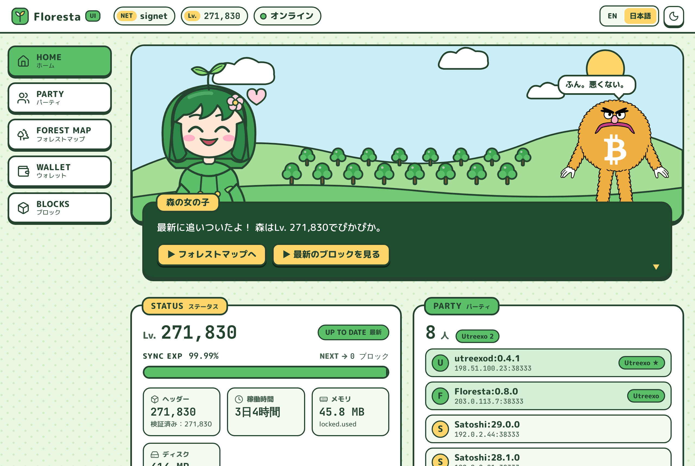

# floresta-ui

[Floresta](https://github.com/getfloresta/Floresta) 用の、小さくて依存の少ないWeb UIです。

ブラウザから `florestad` の同期状況、ピア（Utreexo対応ピアを強調）、Utreexoの森、
監視専用ウォレット、ブロックを見られます。森の女の子とbittyくんがノードの状態を
教えてくれて、問題があれば該当する画面へ案内します（たとえばUtreexo対応ピアが
2台未満だと、Florestaは同期を進められません）。

[English README](README.md)



## はじめかた

Python 3.10以上だけで動きます。`pip install` もビルドも不要です。

1. いつもどおり `florestad` を起動します（ビルド方法はFlorestaの
   [Linux](https://github.com/getfloresta/Floresta/blob/master/doc/build-unix.md)／
   [macOS](https://github.com/getfloresta/Floresta/blob/master/doc/build-macos.md) 向けの手順を参照）。
   メインネットの同期には時間がかかります。まず試すなら `florestad -n signet` が手軽です。
2. 同じマシンに floresta-ui を置きます（GitHubからZIPでダウンロード、または git）。
   ```bash
   git clone https://github.com/Itokichi0000/Floresta-gui-matt floresta-ui
   ```
3. 起動します。
   - **Mac**：Finderで `start.command` をダブルクリック。初回はmacOSに止められることがあるので、右クリック →「開く」→ 確認で開きます。
   - **ターミナル（Mac／Linux）**：
     ```bash
     ./start.command
     ```
     （`python3 server/serve.py --open` と同じです）

ブラウザで <http://127.0.0.1:3000> が開きます。floresta-ui は動いている florestad を
どのネットワーク（mainnet・signet・testnet・testnet4・regtest）でも自動で見つけ、
`~/.floresta` のcookieを読みます。ターミナルに見つけた内容が出ます。

```
floresta-ui 0.1.0
  UI:        http://127.0.0.1:3000/
  florestad: http://127.0.0.1:38332 (network: signet, detected automatically)
  status:    connected (signet, height 271,830 of 271,830)
```

右上の「EN / 日本語」で言語を、月／太陽のボタンで昼の森（ライト）と夜の森（ダーク）を切り替えられます。

### 常に動かしておく（ログイン時に自動起動）

```bash
contrib/install-service.sh
```

Macではlaunchdのエージェントとして、Linuxではsystemdのユーザーサービスとして登録され、
裏で動き続け、再起動後も自動で立ち上がります。実行前に `export` した設定
（例：`FLORESTA_NETWORK=signet`）も引き継ぎます。やめるときは `contrib/install-service.sh --uninstall`。

### スマホから開く（家のネットワーク）

初期設定ではこのコンピューターからしか開けません。同じWi-Fiのスマホから見るには：

```bash
UI_BIND=0.0.0.0:3000 ./start.command
```

スマホで `http://<コンピューターのIPアドレス>:3000` を開きます（MacならIPアドレスは
システム設定 → Wi-Fi → 詳細）。ログイン機能はまだないので、信頼できるネットワークでだけ使ってください。
`mynode.local` のような名前で開きたいときは `UI_ALLOWED_HOSTS=mynode.local` も指定します。

### うまく動かないとき

| 表示 | 対処 |
|---|---|
| 「ノードに接続できません」 | florestadが起動していないか、RPCが127.0.0.1にありません。起動すれば自動でつながります。別の場所で待ち受けているなら `FLORESTAD_URL` を指定。 |
| 「florestadに認証を断られました」 | 正しいcookieを読めていません。florestadと同じユーザーで起動し、florestadに `--data-dir` を付けているなら `FLORESTA_DATADIR` を同じフォルダに。`--rpc-user/--rpc-password` なら `FLORESTA_RPC_USER` / `FLORESTA_RPC_PASSWORD` を指定。 |
| 「同期が止まっている可能性」／Utreexo 0〜1 | FlorestaはUtreexo対応ピアが2台以上必要です。PARTY画面を確認し、「仲間を呼ぶ」で追加するか、外向きの通信が許可されているか確認。 |
| メモリが「取得不可」 | macOSとLinux(glibc)以外では正常です（florestadが0を返します）。 |
| ブロックの中身が出ない | 中身はピアから取り寄せます（最大30秒）。ピアが少ないと失敗しますが、ヘッダーは正しいままです。 |
| `Address already in use` | 3000番ポートが使用中です。`UI_BIND=127.0.0.1:3100 ./start.command` のように変えます。 |

### Dockerで動かす

```bash
docker compose up
```

florestad（`dlsz/floresta`）とUIが起動し、<http://127.0.0.1:3000> で開けます。
signetなら `FLORESTA_NETWORK=signet docker compose up`。同期を待たずに画面だけ
試すなら、同梱の偽ノードを使います（<http://127.0.0.1:3001>）：

```bash
docker compose --profile demo up ui-demo
```

### ノードなしで開発する

`server/mock_florestad.py` は本物と同じ形で応答する偽のflorestadです。

```bash
python3 server/mock_florestad.py
```

UIを起動するコマンドを表示します。`--ibd`（同期中）、`--stalled`（停止）、
`--few-utreexo`（Utreexoピア不足）、`--getblock-fail`（ブロック取得失敗）で状態を再現できます。

## 設定

通常は何も設定しなくても動きます。

| 変数 | 既定値 | 意味 |
|---|---|---|
| `FLORESTAD_URL` | `http://127.0.0.1:<ネットワークのポート>` | florestadのRPCの場所 |
| `FLORESTA_DATADIR` | `~/.floresta` | cookieを探すデータディレクトリ |
| `FLORESTA_NETWORK` | 自動検出 | `bitcoin`・`signet`・`testnet`・`testnet4`・`regtest`。cookieのパスと既定ポートを決めます。未指定なら動いているflorestadのネットワークを使います |
| `FLORESTA_RPC_USER` / `FLORESTA_RPC_PASSWORD` | なし | 指定するとcookieの代わりに使う |
| `UI_BIND` | `127.0.0.1:3000` | UIを待ち受ける場所 |
| `UI_ALLOWED_HOSTS` | なし | 追加で受け付けるホスト名（例：`mynode.local`） |
| `UI_ALLOW_DANGEROUS` | オフ | `stop` と `sendrawtransaction` も許可（`--allow-dangerous`） |

## 仕組みと安全性

ブラウザはflorestadに直接つながらず、同じオリジンの `/api/rpc` にメソッド名と引数だけを送ります。
中継サーバー `serve.py`（Python標準ライブラリのみ）がcookieを読み、許可リストにあるメソッドだけを
Basic認証付きで転送します。cookieはブラウザ・ログ・エラーメッセージに一切出ません。

- 初期設定では `127.0.0.1` でのみ待ち受けます。LANに公開するときは `UI_BIND=0.0.0.0:3000` を明示します（警告が出ます。ログイン機能はまだありません）。
- 他サイトからのリクエストとDNSリバインディングは、Content-Type・Origin・Hostの検査で防ぎます。
- CDNは使わず、フォントとアイコンは `static/vendor/` に同梱しています。
- ウォレット画面は、秘密鍵（`xprv`、`tprv`、WIF）らしき入力を送信前に止めます。

## 対応するFlorestaのバージョン

Florestaの `master`（Bitcoin Core互換のRPC名、cookie認証）を基準にしています。
Docker Hubの `dlsz/floresta`（florestad 0.9.x、RPC認証なし）の古いフィールド名にも対応しています。

## floresta-webuiとの関係

Davidson Souza氏の [floresta-webui](https://github.com/Davidson-Souza/floresta-webui) の目標
（シンプル・依存が少ない・壊れにくい、良いUX、動かしやすい）を受け継いだ実装です。
設計書は [docs/DESIGN.md](docs/DESIGN.md) にあります。

## クレジット

- **bittyくん**：Spiralの [Here Comes Bitcoin](https://www.herecomesbitcoin.org/)（「No Copyright — Make Whatever You Want」）。使用した素材は `static/assets/characters/README.md` に記載。
- **森の女の子**：このプロジェクトのためのオリジナルキャラクター（名前は未定）。
- フォント：M PLUS Rounded 1c、JetBrains Mono（SIL OFL 1.1）。アイコン：Lucide（ISC）。

## ライセンス

[MIT](LICENSE)
