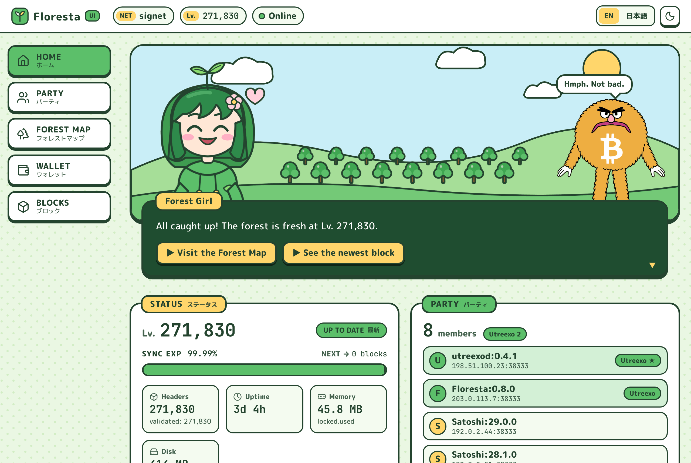
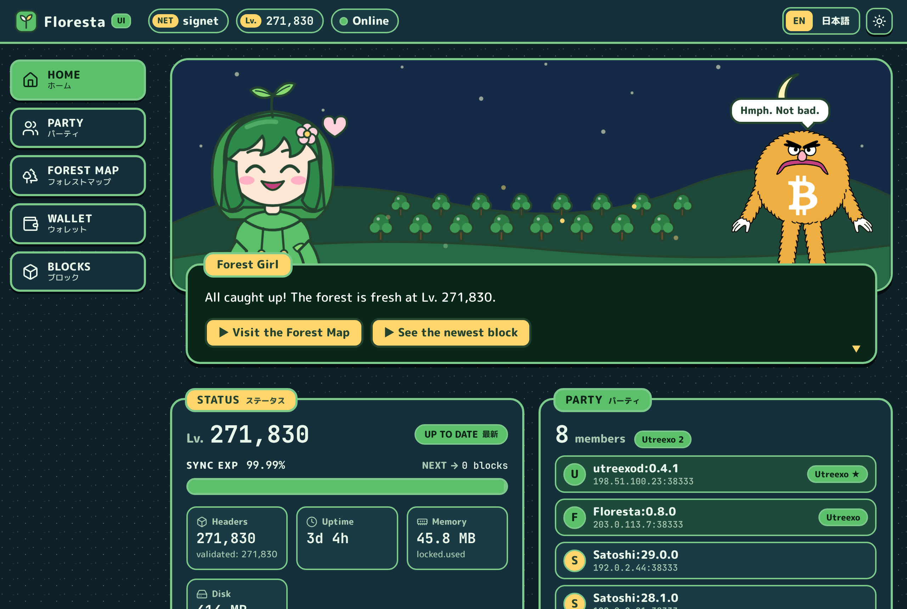
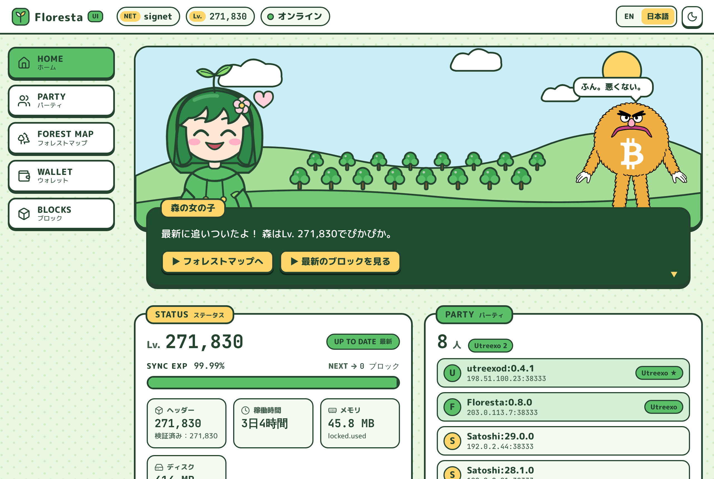
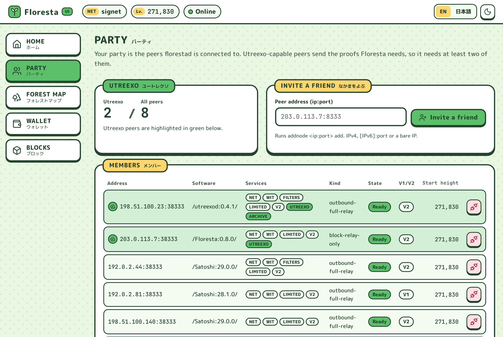
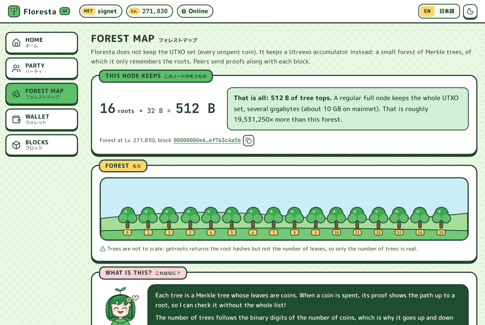
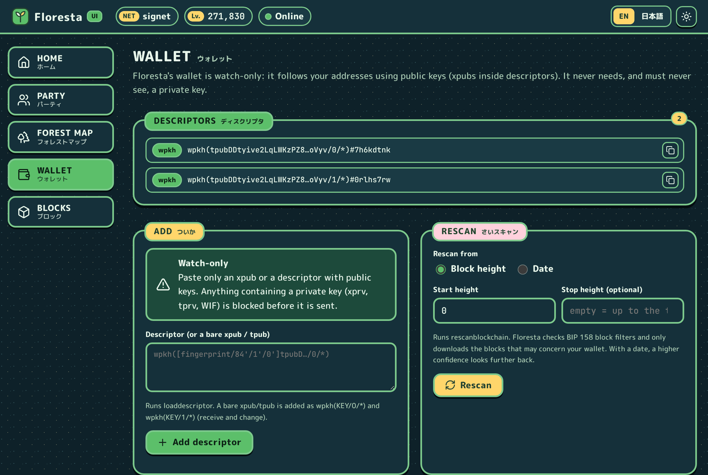
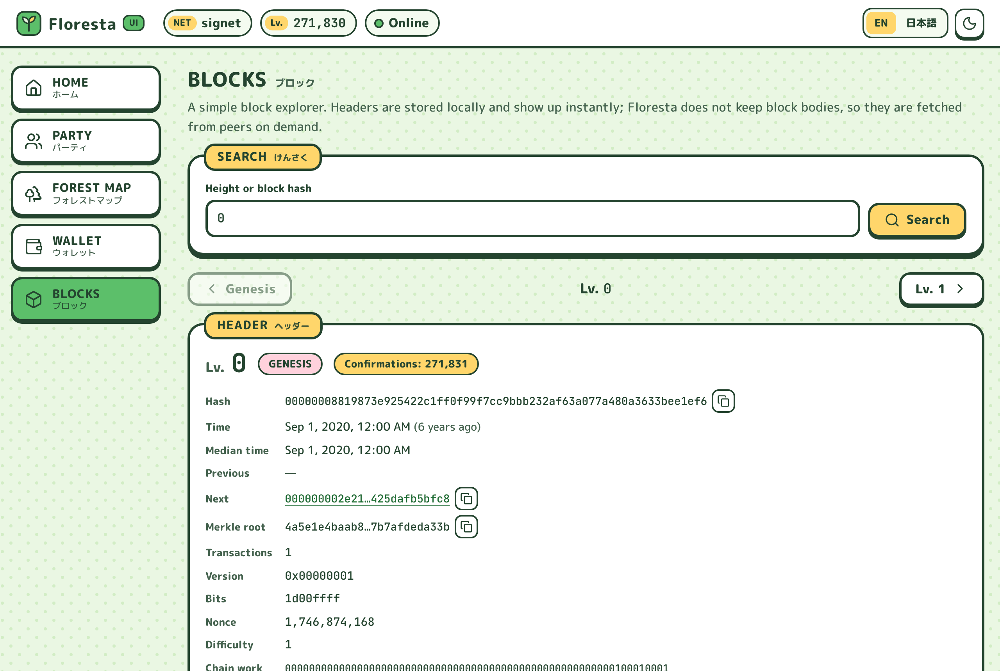
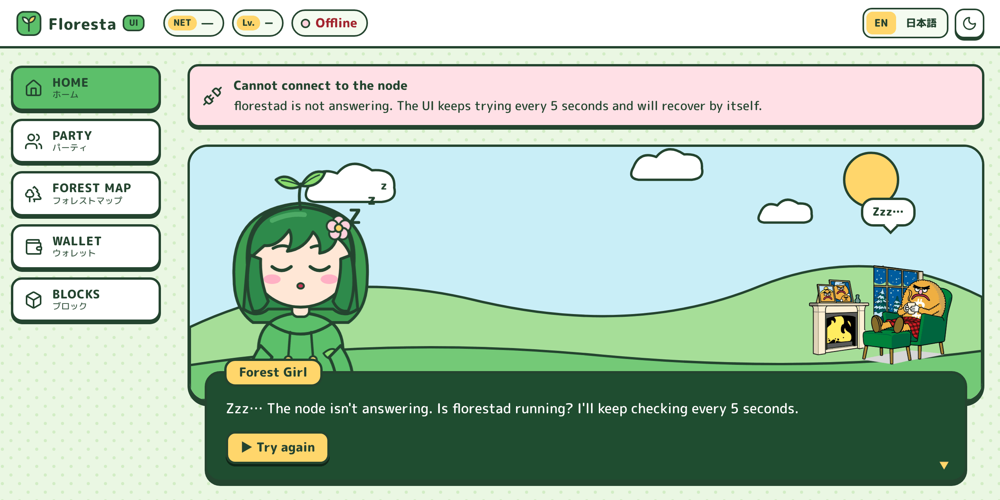
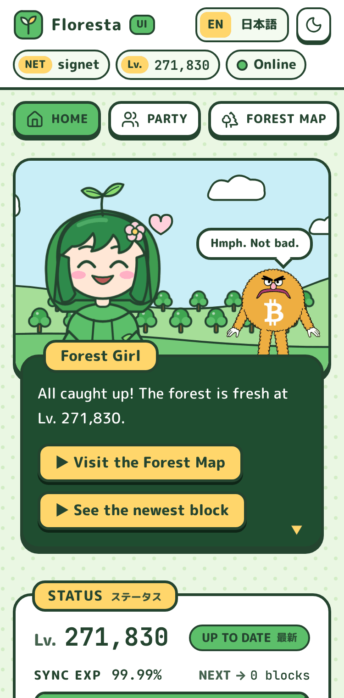

# floresta-ui

A small, low-dependency web UI for [Floresta](https://github.com/getfloresta/Floresta).

Watch your `florestad` from a browser: sync progress, peers (with Utreexo
peers highlighted), the Utreexo forest, your watch-only wallet and blocks.
A forest girl and bitty tell you how the node is doing, and point you to the
right screen when something is wrong. For example, when fewer than two
Utreexo-capable peers are connected, Floresta cannot make progress.

[日本語の README はこちら](README.ja.md)



| Night forest (dark mode) | 日本語 |
|---|---|
|  |  |
| **PARTY** (peers) | **FOREST MAP** (Utreexo roots) |
|  |  |
| **WALLET** (watch-only descriptors) | **BLOCKS** (explorer) |
|  |  |
| **Node unreachable** | **Phone (375 px)** |
|  |  |

## Run

You need Python 3.10 or newer, and nothing else: no `pip install` and no build step.

```bash
python3 server/serve.py
```

Then open <http://127.0.0.1:3000>. The UI finds florestad's RPC cookie in
`~/.floresta` by itself. For another network:

```bash
FLORESTA_NETWORK=signet python3 server/serve.py
```

### With Docker

```bash
docker compose up
```

This starts florestad (`dlsz/floresta`) and the UI on <http://127.0.0.1:3000>.
Use `FLORESTA_NETWORK=signet docker compose up` for signet. To try the UI
without syncing a chain, run it against the bundled mock node:

```bash
docker compose --profile demo up ui-demo
```

That one is on <http://127.0.0.1:3001>.

### Without a node (development)

`server/mock_florestad.py` is a fake florestad that answers like the real
one, writes a cookie and grows its chain on its own:

```bash
python3 server/mock_florestad.py
```

It prints the command that starts the UI against it. The mock can also
pretend to be syncing (`--ibd`), stuck (`--stalled`), short of Utreexo peers
(`--few-utreexo`) or unable to fetch blocks (`--getblock-fail`).

## Configuration

Environment variables (or the flags in `python3 server/serve.py --help`):

| Variable | Default | Meaning |
|---|---|---|
| `FLORESTAD_URL` | `http://127.0.0.1:<network port>` | florestad's JSON-RPC address |
| `FLORESTA_DATADIR` | `~/.floresta` | where to find the `.cookie` |
| `FLORESTA_NETWORK` | `bitcoin` | `signet`, `testnet`, `testnet4` or `regtest` switch the cookie path and the default port (8332, 38332, 18332, 48332, 18442) |
| `FLORESTA_RPC_USER` / `FLORESTA_RPC_PASSWORD` | none | used instead of the cookie when set |
| `FLORESTA_RPC_COOKIE_FILE` | `<datadir>/[<network>/].cookie` | explicit cookie path |
| `UI_BIND` | `127.0.0.1:3000` | where the UI listens |
| `UI_ALLOWED_HOSTS` | none | extra host names to accept, e.g. `mynode.local` |
| `UI_ALLOW_DANGEROUS` | off | also allow `stop` and `sendrawtransaction` (`--allow-dangerous`) |

## How it works

```
browser ──POST /api/rpc {"method", "params"}──▶ serve.py ──JSON-RPC + Basic auth──▶ florestad
          (same origin, no credentials)          reads .cookie, allow-list
```

The browser never talks to florestad and never sees the cookie. `serve.py`
(Python standard library only) serves the static files and relays an
allow-listed set of RPC methods:

* **Read:** `getblockchaininfo`, `getbestblockhash`, `getblockcount`, `getblockhash`,
  `getblockheader`, `getblock`, `getpeerinfo`, `getconnectioncount`, `getnetworkinfo`,
  `getmemoryinfo`, `getroots`, `uptime`, `listdescriptors`, `getrpcinfo`,
  `getaddrmaninfo`, `getdeploymentinfo`
* **Change state** (the UI asks for confirmation): `addnode`, `disconnectnode`,
  `loaddescriptor`, `rescanblockchain`
* **Dangerous**, off unless `--allow-dangerous`: `stop`, `sendrawtransaction`

The cookie is read again whenever it changes or florestad answers 401, so
restarting florestad is fine. If florestad is down, the relay answers
`502 {"error": "node_unreachable"}`, and the UI says so and keeps retrying.

You can call the relay yourself:

```bash
curl -X POST localhost:3000/api/rpc -d '{"method":"getblockcount"}'
```

### Security

* The UI listens on `127.0.0.1` by default. `UI_BIND=0.0.0.0:3000` exposes it to
  your LAN (a warning is printed). There is no login yet, so only do this on
  a network you trust.
* The cookie never appears in logs, errors or responses.
* Browser requests must be same-origin `application/json`, and the `Host` header
  must be an IP address, `localhost` or a name in `UI_ALLOWED_HOSTS`. This
  blocks cross-site requests and DNS rebinding.
* A strict Content-Security-Policy, and no CDN: fonts and icons are in
  `static/vendor/`, so nothing about your node leaks to third parties.
* Floresta's wallet is watch-only. The wallet screen refuses anything that looks
  like a private key (`xprv`, `tprv`, WIF) before sending it.

## Floresta versions

The UI targets Floresta `master` (Bitcoin Core-style RPC names, cookie auth;
see [doc/rpc](https://github.com/getfloresta/Floresta/tree/master/doc/rpc)).
It also understands the older field names of florestad 0.9.x, the version
published as `dlsz/floresta` on Docker Hub, which has no RPC authentication.

## Relationship with floresta-webui

This project carries on the goals of Davidson Souza's
[floresta-webui](https://github.com/Davidson-Souza/floresta-webui): simple,
few dependencies, stable, most of Floresta's features with a nice UX, easy to
run (also on a separate "node in a box" device). It keeps that project's shape
(plain HTML/CSS/JS, a small Python server, `FLORESTAD_URL`, 5-second
refresh, light and dark themes), and adds cookie auth through a relay and
support for the current RPC format.

| floresta-webui goal | Here |
|---|---|
| Stats: uptime, resources, best chain, peers | Home |
| Add descriptors / xpubs to watch | Wallet |
| See what's inside blocks | Blocks |
| Browse your transactions, scan an address | not yet |
| Export assume-utreexo values as a QR code | not yet (planned on the Forest Map) |

The full design document is [docs/DESIGN.md](docs/DESIGN.md) (in Japanese).

## Development

```bash
python3 -m unittest discover -s server   # relay + mock tests
node --test tests/js/*.test.mjs          # pure JS helpers
```

See [CONTRIBUTING.md](CONTRIBUTING.md).

## Credits

* **bitty** is from [Here Comes Bitcoin](https://www.herecomesbitcoin.org/)
  by Spiral. Their assets are "No Copyright — Make Whatever You Want". The
  files used are listed in `static/assets/characters/README.md`.
* The forest girl is an original character drawn for this project. She does
  not have a name yet.
* Fonts: [M PLUS Rounded 1c](https://fonts.google.com/specimen/M+PLUS+Rounded+1c)
  and [JetBrains Mono](https://www.jetbrains.com/lp/mono/) (SIL OFL 1.1).
  Icons: [Lucide](https://lucide.dev) (ISC). See `static/vendor/README.md`.

## License

[MIT](LICENSE)
